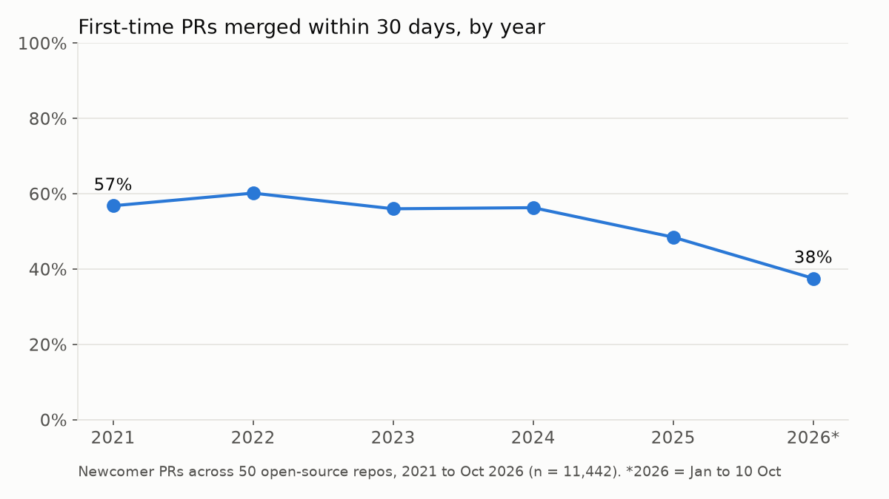
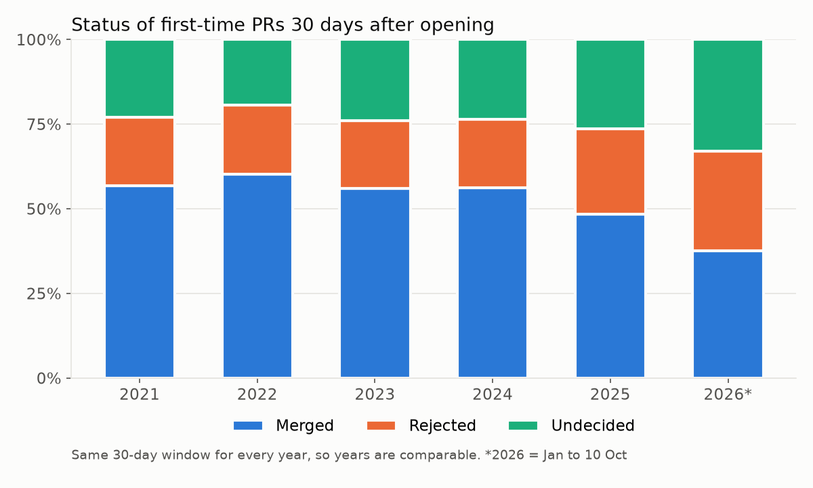
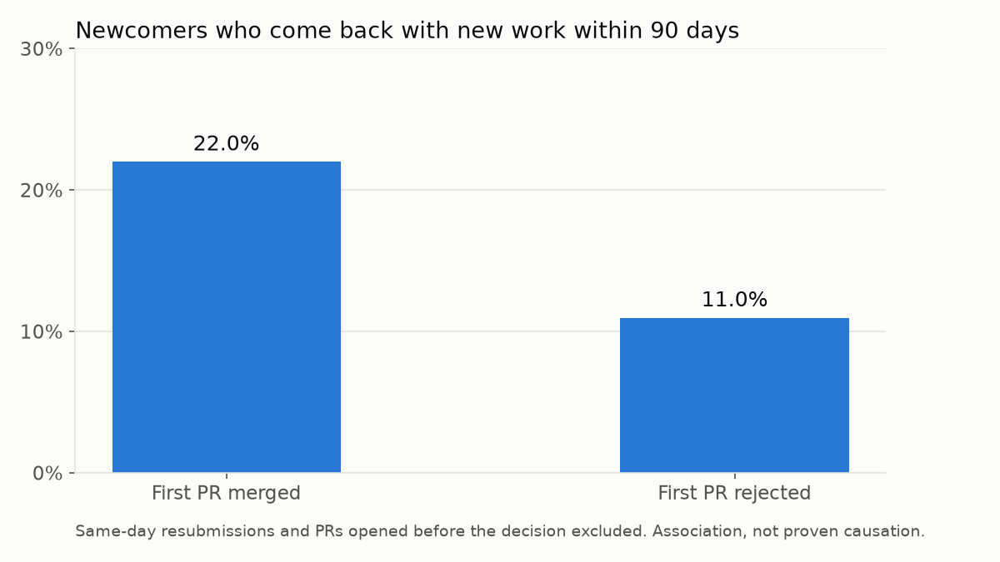
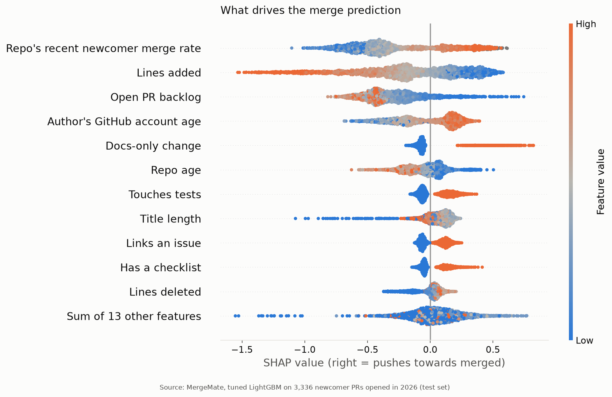

# MergeMate

**Predicting whether a first-time contributor's pull request will be merged, and helping them improve it before they submit.**

Most people who open their first pull request to an open-source project never come back. I wanted to understand why, using real GitHub data, and then build something that could help: a model that estimates a newcomer's chance of getting merged, and a coach that checks their PR against the project's own contribution rules.

> **Status:** data collection, product analytics, modelling, the final 2026 test, SHAP explanations and calibration are done. The RAG coach and the deployed app are in progress (see [Roadmap](#roadmap)).

---

## What I found

Data: 189,606 pull requests from 50 open-source repositories (Go, Java, Python, Rust, JavaScript/TypeScript), collected through the GitHub REST and GraphQL APIs in November 2026.

**1. Newcomer success has dropped sharply.** In 2021–2024, about 57% of first-time PRs were merged within 30 days. In 2026 so far, it's 38%. The drop happens inside the same repositories, so it isn't explained by which projects are in the sample.



**2. Both rejections and silence are growing.** Looking at every PR's status exactly 30 days after it was opened, the fall is split roughly evenly between more PRs being closed without merging and more PRs still waiting for a decision. Over the same period, the number of newcomer PRs per repository more than doubled.



**3. Getting merged is linked to coming back.** Newcomers whose first PR was merged were twice as likely to return with new work within 90 days (22.0% vs 11.0%). This took some digging: a naive comparison showed almost no difference, because many "returns" after a rejection were the same change resubmitted within a day. Once those were separated out, the gap appeared. This is an association, not proof of cause.



**4. About one in five newcomer PRs never gets a human reply within 30 days, and almost none of those are merged (3.4%).** When a human does reply, it's usually within about 10 hours, and that hasn't changed over the years. What's changed is how many PRs get no reply at all.

**5. AI reviewers are now among the most active accounts on newcomer PRs.** CodeRabbit was the single most active commenter in the dataset. I excluded AI reviewers and other bots when measuring human response time.

**6. The repository matters more than the PR, but PR size is the biggest thing a newcomer controls.** The strongest signal in the model is how often the repo has merged newcomer PRs recently, which says more about the maintainers than the contributor. Among things a newcomer can change, size dominates, and the effect is lopsided: a very large PR is pulled down far more than a small one is lifted up. See [Explaining predictions](#explaining-predictions).

---

## How it works

```mermaid
flowchart LR
    A[GitHub Search API<br/>candidate repos] --> B[Eligibility rules<br/>600 sampled → 50 repos]
    B --> C[Pass 1: GraphQL<br/>189k PRs]
    C --> D[(DuckDB)]
    D --> E[Cleaning + newcomer flag<br/>+ 30-day target]
    E --> F[Pass 2: GraphQL<br/>details for 11k newcomer PRs]
    F --> G[Point-in-time features]
    G --> H[LightGBM + Optuna<br/>time-based validation, MLflow]
    H --> X[SHAP<br/>per-PR explanations]
    X --> I[RAG coach + app]
```



## Data

### Choosing the repositories

I didn't want to hand-pick famous projects, so I built a selection process and wrote the rules down before running it.

| Step | Repos |
|---|---|
| GitHub search: 6 languages, 5+ open "good first issue" issues, active, not archived or forked | ~3,900 matches |
| Random sample (100 per language, fixed seed) | 600 |
| 1,000–20,000 total PRs | 216 |
| Active in the last 3 months, has a CONTRIBUTING file | 164 |
| Merges through GitHub (>20% merge rate) and accepts outside PRs (>10%) | 152 |
| At least 10 outside PRs in the sample | 136 |
| **Random selection, 10 per language group** | **50** |

The final list is in [`repos.csv`](repos.csv).

### Collection

- **Pass 1** pulls basic fields for every PR in each repo's full history (189,606 PRs) using GraphQL, 50 PRs per query.
- **Pass 2** pulls descriptions, changed files and the first comments and reviews, only for the 11,442 newcomer PRs used in modelling.
- Both collectors save progress after every page and resume from a bookmark, so a dropped connection costs nothing. Writes are idempotent (`INSERT OR REPLACE` on a primary key).
- Everything is stored in DuckDB. Cleaning rules live in SQL views on top of the raw tables, so the raw data is never changed.

### Cleaning

- Removed bot accounts, including bots registered as normal users (16.1% of PRs).
- Removed deleted accounts and one PR with an impossible timeline.
- Excluded PRs from a repository's first 90 days. These were mostly founders and core teams, or projects that had just moved to GitHub, and they were merged far more often than real newcomer PRs (72% vs 50%).

---

## Defining the problem

- **Newcomer PR:** an author's first PR to that repository, worked out from the full PR history. I didn't use GitHub's `author_association` field for this, because it reflects the author's status *today*, not when the PR was opened (see [What went wrong](#what-went-wrong-and-what-i-learned)).
- **Target:** merged within 30 days of being opened. 88.5% of eventual newcomer merges happen within 30 days; the median is 3 days.
- **Censoring:** only PRs opened at least 30 days before data collection are used, so every PR has had its full 30 days.
- **Modelling set:** 11,442 newcomer PRs opened between January 2021 and October 2026, 49.7% merged.

---

## Modelling

### Features

Every feature uses only information available at the moment the PR was opened.

| Group | Examples |
|---|---|
| PR size | lines added and deleted, files changed (log-scaled) |
| Files touched | tests, docs only, CI config, dependency files, how many top-level folders |
| Description | length, empty or not, mentions an issue (`fixes #123`), ticked checklist, conventional title (`fix:`, `feat:`) |
| Author | account age, earlier PRs to other repos in the dataset |
| Repository at that moment | repo age, open PR backlog, PRs in the last 30 days, recent newcomer merge rate |
| Timing | weekday, hour (UTC), language group |

The repository features are computed as the repo looked at that moment. The recent merge rate, for example, only counts newcomer PRs whose 30-day outcome was already known, so the model never sees results from the future.

Deliberately excluded: anything that happens after opening (comments, reviews, labels, response time), `author_association`, and the year.

### Validation

The merge rate drifts over time (55% in the training years, 37.5% in 2026), so a random split would overstate performance.

- **Train:** January 2021 to 1 December 2025, with five expanding-window cross-validation folds (each validation half-year is trained only on data before it).
- **30-day embargo** between training and validation data in every fold, and before the test set, because the 30-day target would otherwise overlap.
- **Test:** January to October 2026, held out until the end.

### Tuning and tracking

- Every cross-validation run is logged to **MLflow** (parameters, per-fold scores, mean and last-fold scores), so model comparisons don't live in my terminal history.
- LightGBM was tuned with **Optuna** (40 trials, TPE sampler, fixed seed) on the cross-validation folds only. The objective weights the two most recent folds double, because those look most like the data the model will actually face.

### Cross-validation results (mean of 5 folds)

| Model | ROC-AUC | PR-AUC | Most recent fold ROC-AUC |
|---|---|---|---|
| Repo's recent merge rate only | 0.693 | 0.693 | |
| Logistic regression, all features | 0.743 | 0.767 | 0.704 |
| LightGBM, tuned | **0.763** | **0.780** | **0.742** |

The repository a newcomer picks explains a lot on its own. The PR's own features add a meaningful amount on top, and those are the things a newcomer can actually change.

### Final test on 2026 data

Run once, after all tuning was finished.

| Model | ROC-AUC | PR-AUC | Brier score | Mean predicted |
|---|---|---|---|---|
| Logistic regression | 0.713 | 0.619 | 0.203 | 0.406 |
| LightGBM, tuned | 0.714 | 0.610 | 0.203 | 0.416 |
| *Actual merge rate* | | | | *0.375* |

On 2026 data the two models are effectively tied. LightGBM's lead in cross-validation didn't carry over, and both lose about 0.03–0.05 ROC-AUC compared with cross-validation. The main limit isn't the algorithm, it's drift: the merge rate in 2026 is lower than anything in the training data, and both models still expect it to be a bit higher (about 41% predicted vs 37.5% actual).

I kept **LightGBM as the app model** and logistic regression as the benchmark. It was ahead in cross-validation, on average and on the most recent fold, it picks up non-linear patterns that a linear model can't (title length has a sweet spot rather than "longer is better"), and tree-based SHAP gives exact explanations for each prediction. I'm not claiming it beats the simpler model on 2026 data, because it doesn't.

### Calibration

The app shows newcomers a percentage, so the percentages need to be honest, not just the ranking. On 2026 data the model was too optimistic: it predicted 41.6% on average when 37.5% were merged, and in the weakest tenth of PRs it said 18% when the real rate was 8%.

The cause is the same drift as before. The model learnt what "normal" looks like from years when more newcomer PRs got merged. So the fix shifts every score down by one constant in log-odds, which keeps the order of PRs (and the ROC-AUC) unchanged and keeps every score between 0 and 100%.

To keep the test honest, the size of the shift came only from pre-2026 data. In each cross-validation fold I measured how much the model over-predicted the following half-year. The shift was close to zero in 2023 and early 2024, then turned negative once the merge rate started falling (−0.14, −0.12, −0.21). I used the average of those three drift-era folds, −0.16, and checked it on 2026 once.

| 2026 test | Mean predicted | ECE | Brier score | ROC-AUC |
|---|---|---|---|---|
| Before | 0.416 | 0.045 | 0.203 | 0.714 |
| After shift | **0.382** | **0.028** | 0.202 | 0.714 |

*Actual merge rate: 0.375. ECE is the average gap between predicted and actual rates across ten equal-sized groups.*

The calibration error dropped by more than a third. The middle 80% of PRs are now within about 3 points. The two ends still miss in opposite directions: the weakest PRs are worse than the model thinks, and the strongest are better. That's a spread problem a single shift can't fix, and fixing it properly would mean learning from 2026 data, so I've left it as a known limitation.

For the app, the shift is refreshed from the most recent 90 days with known outcomes (1,349 PRs), the way a production model would be maintained month to month. That refresh gave −0.18, close to the −0.16 learnt from 2025, which suggests the correction is stable. It uses 2026 data, so it can't be re-tested on 2026; the honest test result is the table above.

### Explaining predictions

I used SHAP to break each prediction into the push from every feature.



What the model relies on, across all 2026 test PRs:

- **Repository context comes first.** The repo's recent newcomer merge rate is the strongest signal, followed by the open PR backlog. Busy repos with large backlogs merge fewer newcomer PRs.
- **Size is the biggest thing a newcomer controls, and it cuts one way.** Large PRs lose up to 1.5 in log-odds; very small ones gain about 0.5.
- **New GitHub accounts do worse.** This probably reflects trust rather than skill, since brand-new accounts include a lot of one-off and low-effort PRs.
- **Older repos are slightly harder to get into.** Mature projects tend to have stricter standards and more people competing for review time.
- **Docs-only changes, touching tests, linking an issue and filling in the checklist all help.** Very short titles hurt.
- **Three features contribute nothing:** touching CI config, the yes/no "has PRs elsewhere" flag and the empty-description flag. The last two duplicate more detailed features. I left them in rather than change the model after the test set had been used.

These are patterns the model uses, not causes. Docs-only PRs get merged more because they're easier to review, not because writing docs is a strategy.

For a single PR, the app splits the explanation into two groups:

- **What you can improve:** size, tests, linking an issue, the checklist, title and description.
- **Context:** the repo's merge rate, backlog and age, the author's account age, language and weekday. Docs-only sits here too, because "make your bug fix a docs change" isn't advice anyone can follow.

The split is my judgement, not something the model learnt. The calibration shift moves every PR's baseline by the same amount, so it doesn't change any of these pushes. Two small rules keep the advice sensible: a docs-only PR is never told to add tests, and the hour a PR was opened is never shown, because the effect is tiny, it's in UTC, and it's unlikely to be causal.

---

## What went wrong, and what I learned

- **A field that leaked the answer.** My first plan used GitHub's `author_association` to find newcomers. A quick check showed PRs labelled `NONE` were merged 0% of the time and `CONTRIBUTOR` 94% of the time. GitHub updates the label after a merge, so it was encoding the outcome. I dropped it and built the newcomer flag from PR history instead.
- **Timeouts and hidden rate limits.** The first full collection run hit GitHub's secondary rate limit and server timeouts on 18 of 50 repos. Smaller pages, a pause between requests, and waiting for the time GitHub asks for (`retry-after`) fixed it. Pass 2 later ran with almost no errors.
- **An effect hidden by resubmissions.** The first retention analysis said a newcomer's first experience didn't matter. Breaking down when people came back showed 64% of "returns" after a rejection happened within a day, which were mostly the same change resubmitted.
- **A crash that wasn't my code.** LightGBM 4.7 crashed Python outright (an access violation) as soon as training started. Before switching to XGBoost I wanted to know why, so I narrowed it down: it crashed even on random data, and changing the NumPy version, the OpenMP runtime and the data types made no difference. LightGBM 4.5 failed for a different reason (incompatible with my scikit-learn version), while 4.6.0 worked. The cause was the 4.7 release itself, so I pinned `lightgbm==4.6.0`.
- **Not tuning on the test set.** It would have been easy to keep adjusting the model after seeing the 2026 score. I tuned only on cross-validation folds, ran the test once, and reported the tie as it came out.
- **Comparing years fairly.** Raw "still open" counts made 2026 look terrible, but recent PRs simply hadn't had as much time. Measuring every PR at exactly day 30 fixed the comparison.

## Limitations

- The 50 repositories are active, newcomer-friendly projects with 1k–20k PRs. Results may not hold for very small or very large projects.
- PR size, files and descriptions are their final values, not necessarily what was submitted.
- Some company employees appear as outside contributors because their organisation membership is private.
- "Earlier PRs elsewhere" only counts PRs within these 50 repositories.
- The retention and response-time findings are associations, not causal effects.
- Calibration is fixed on average, but scores are still too bunched towards the middle: the weakest PRs are over-predicted and the strongest slightly under-predicted.
- The drift correction needs refreshing as the merge rate moves. A model left alone will drift out of calibration again.

---

## Roadmap

- [x] Repository selection and data collection (REST + GraphQL)
- [x] Cleaning, newcomer definition, 30-day target
- [x] Product analytics: funnel, retention, drift, response time
- [x] Point-in-time features and logistic regression baseline
- [x] Gradient boosting with hyperparameter tuning (Optuna) and experiment tracking (MLflow)
- [x] Final test on 2026 data
- [x] SHAP explanations, global and per PR
- [x] Calibration of predicted probabilities (drift-aware level shift)
- [ ] RAG coach: checks a PR against the repo's CONTRIBUTING.md and PR template
- [ ] A/B test design for the coach
- [ ] FastAPI + Streamlit app, deployed

## Repository structure

```
src/
  github_client.py      shared REST and GraphQL client with retries and rate-limit handling
  db.py                 DuckDB connection and table setup
  search_repos.py, check_rules*.py, select_final_repos.py    repository selection
  collect_pass1.py      full PR history (GraphQL, resumable)
  collect_pass2.py      details for newcomer PRs (GraphQL, resumable)
  build_views.py        cleaning, newcomer flag, target (SQL views)
  features.py           point-in-time feature tables
  model_config.py       feature lists, readable labels, time-based folds, tuned parameters
  train_baseline.py     rule-based and logistic regression baselines
  train_lgbm.py         first LightGBM run
  train_cv.py           cross-validation with MLflow logging
  tune_lgbm.py          Optuna tuning on the cross-validation folds
  final_eval.py         one-time 2026 test, saves the final model
  calibration.py        drift correction: one log-odds shift for every score
  refresh_level_shift.py  refits the app's shift on the latest 90 days
  explain.py            per-PR probability and SHAP explanation, split into fixable vs context
analysis/               data quality checks, funnel, retention, drift, response time, SHAP, charts
models/                 the trained LightGBM model and the current calibration shift, both used by the app
docs/figures/           charts used in this README
repos.csv               the 50 selected repositories
```

## Running it

```bash
python -m venv .venv
.venv\Scripts\activate          # Windows; use source .venv/bin/activate on macOS/Linux
pip install -r requirements.txt
```

Create a `.env` file with a GitHub token (read-only access to public repositories is enough):

```
GITHUB_TOKEN=your_token_here
```

Then, in order:

```bash
python src/db.py
python src/collect_pass1.py      # several hours; safe to stop and restart
python src/build_views.py
python src/collect_pass2.py      # about an hour
python src/build_views.py
python src/features.py
python src/train_baseline.py
python src/train_cv.py
python src/tune_lgbm.py          # about 40 trials
python src/final_eval.py         # runs the 2026 test and saves models/lgbm_final.joblib
python analysis/09_shap.py
python analysis/12_level_shift.py      # how much each fold over-predicts the next half-year
python analysis/13_calibration_test.py # before/after calibration on 2026
python src/refresh_level_shift.py      # writes models/level_shift.json for the app
```

To browse the experiment runs:

```bash
mlflow ui --backend-store-uri sqlite:///mlflow.db
```

## Built with

Python, DuckDB, SQL, pandas, scikit-learn, LightGBM, Optuna, MLflow, SHAP, matplotlib, GitHub REST and GraphQL APIs. Planned: LangChain, Claude, Chroma, FastAPI, Streamlit, Docker.

---

Data comes from public GitHub repositories through the GitHub API. Numbers reflect data collected on 10–11 November 2026.