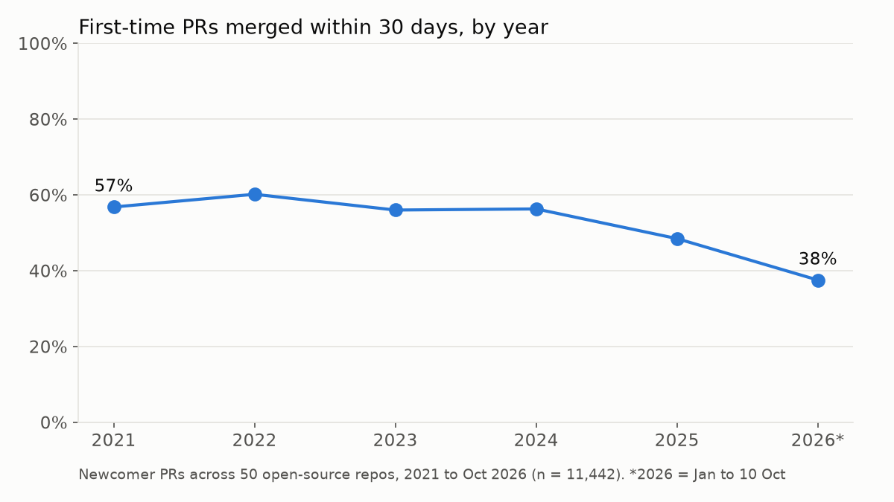
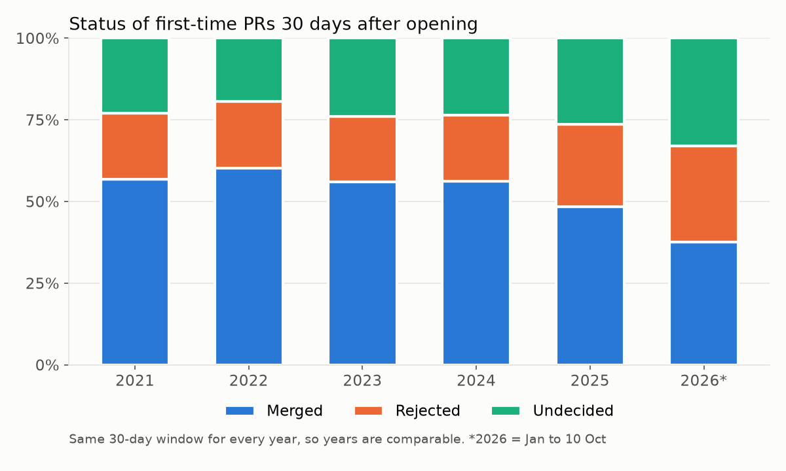
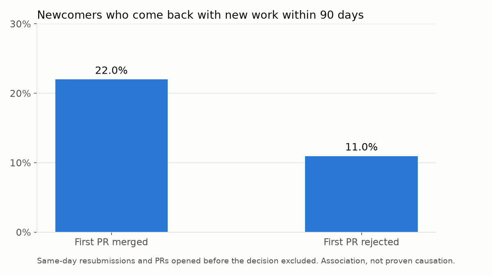
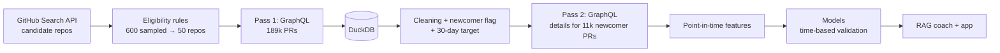

# MergeMate

**Predicting whether a first-time contributor's pull request will be merged, and helping them improve it before they submit.**

Most people who open their first pull request to an open-source project never come back. I wanted to understand why, using real GitHub data, and then build something that could help: a model that estimates a newcomer's chance of getting merged, and a coach that checks their PR against the project's own contribution rules.

> **Status:** data collection, product analytics, feature engineering and the baseline model are done. Gradient boosting, explainability, the RAG coach and the deployed app are in progress (see [Roadmap](#roadmap)).

---

## What I found

Data: 189,606 pull requests from 50 open-source repositories (Go, Java, Python, Rust, JavaScript/TypeScript), collected through the GitHub REST and GraphQL APIs in November 2026.

**1. Newcomer success has dropped sharply.** In 2021–2024, about 57% of first-time PRs were merged within 30 days. In 2026 so far, it's 38%. The drop happens inside the same repositories, so it isn't explained by which projects are in the sample.



**2. Both rejections and silence are growing.** Looking at every PR's status exactly 30 days after it was opened, the fall is split roughly evenly between more PRs being closed without merging and more PRs still waiting for a decision. Over the same period, the number of newcomer PRs per repository more than doubled.



**3. Getting merged is linked to coming back.** Newcomers whose first PR was merged were twice as likely to return with new work within 90 days (22.0% vs 11.0%). This took some digging: a naive comparison showed almost no difference, because many "returns" after a rejection were the same change resubmitted within a day. Once those were separated out, the gap appeared. This is an association, not proof of cause.



**4. About one in five newcomer PRs never gets a human reply within 30 days, and almost none of those are merged (3.4%).** When a human does reply, it's usually within about 10 hours, and that hasn't changed over the years. What's changed is how many PRs get no reply at all.

**5. AI reviewers are now among the most active accounts on newcomer PRs.** CodeRabbit was the single most active commenter in the dataset. I excluded AI reviewers and other bots when measuring human response time.

---

## How it works



## Data

### Choosing the repositories

I didn't want to hand-pick famous projects, so I built a selection process and wrote the rules down before running it.

| Step | Repos |
|---|---|
| GitHub search: 6 languages, 5+ open "good first issue" issues, active, not archived or forked | ~3,900 matches |
| Random sample (100 per language, fixed seed) | 600 |
| 1,000–20,000 total PRs | 216 |
| Active in the last 3 months, has a CONTRIBUTING file | 164 |
| Merges through GitHub (>20% merge rate) and accepts outside PRs (>10%) | 152 |
| At least 10 outside PRs in the sample | 136 |
| **Random selection, 10 per language group** | **50** |

The final list is in [`repos.csv`](repos.csv).

### Collection

- **Pass 1** pulls basic fields for every PR in each repo's full history (189,606 PRs) using GraphQL, 50 PRs per query.
- **Pass 2** pulls descriptions, changed files and the first comments and reviews, only for the 11,442 newcomer PRs used in modelling.
- Both collectors save progress after every page and resume from a bookmark, so a dropped connection costs nothing. Writes are idempotent (`INSERT OR REPLACE` on a primary key).
- Everything is stored in DuckDB. Cleaning rules live in SQL views on top of the raw tables, so the raw data is never changed.

### Cleaning

- Removed bot accounts, including bots registered as normal users (16.1% of PRs).
- Removed deleted accounts and one PR with an impossible timeline.
- Excluded PRs from a repository's first 90 days. These were mostly founders and core teams, or projects that had just moved to GitHub, and they were merged far more often than real newcomer PRs (72% vs 50%).

---

## Defining the problem

- **Newcomer PR:** an author's first PR to that repository, worked out from the full PR history. I didn't use GitHub's `author_association` field for this, because it reflects the author's status *today*, not when the PR was opened (see [What went wrong](#what-went-wrong-and-what-i-learned)).
- **Target:** merged within 30 days of being opened. 88.5% of eventual newcomer merges happen within 30 days; the median is 3 days.
- **Censoring:** only PRs opened at least 30 days before data collection are used, so every PR has had its full 30 days.
- **Modelling set:** 11,442 newcomer PRs opened between January 2021 and October 2026, 49.7% merged.

---

## Modelling

### Features

Every feature uses only information available at the moment the PR was opened.

| Group | Examples |
|---|---|
| PR size | lines added and deleted, files changed (log-scaled) |
| Files touched | tests, docs only, CI config, dependency files, how many top-level folders |
| Description | length, empty or not, mentions an issue (`fixes #123`), ticked checklist, conventional title (`fix:`, `feat:`) |
| Author | account age, earlier PRs to other repos in the dataset |
| Repository at that moment | repo age, open PR backlog, PRs in the last 30 days, recent newcomer merge rate |
| Timing | weekday, hour (UTC), language group |

The repository features are computed as the repo looked at that moment. The recent merge rate, for example, only counts newcomer PRs whose 30-day outcome was already known, so the model never sees results from the future.

Deliberately excluded: anything that happens after opening (comments, reviews, labels, response time), `author_association`, and the year.

### Validation

The merge rate drifts over time (55% in the training years, 37.5% in 2026), so a random split would overstate performance.

- **Train:** January 2021 to 1 December 2025, with five expanding-window cross-validation folds (each validation half-year is trained only on data before it).
- **30-day embargo** between training and validation data in every fold, and before the test set, because the 30-day target would otherwise overlap.
- **Test:** January to October 2026, held out until the end.

### Results so far (cross-validation, mean of 5 folds)

| Model | ROC-AUC | PR-AUC |
|---|---|---|
| Repo's recent merge rate only | 0.693 | 0.693 |
| Logistic regression, all features | 0.743 | 0.767 |
| Gradient boosting | *in progress* | |

The repository a newcomer picks explains a lot on its own. The PR's own features add a meaningful amount on top, and those are the things a newcomer can actually change. Performance falls in the most recent fold (ROC-AUC 0.704), where the merge rate starts to drop, so I expect the 2026 test score to be lower than the cross-validation average.

---

## What went wrong, and what I learned

- **A field that leaked the answer.** My first plan used GitHub's `author_association` to find newcomers. A quick check showed PRs labelled `NONE` were merged 0% of the time and `CONTRIBUTOR` 94% of the time. GitHub updates the label after a merge, so it was encoding the outcome. I dropped it and built the newcomer flag from PR history instead.
- **Timeouts and hidden rate limits.** The first full collection run hit GitHub's secondary rate limit and server timeouts on 18 of 50 repos. Smaller pages, a pause between requests, and waiting for the time GitHub asks for (`retry-after`) fixed it. Pass 2 later ran with almost no errors.
- **An effect hidden by resubmissions.** The first retention analysis said a newcomer's first experience didn't matter. Breaking down when people came back showed 64% of "returns" after a rejection happened within a day, which were mostly the same change resubmitted.
- **Comparing years fairly.** Raw "still open" counts made 2026 look terrible, but recent PRs simply hadn't had as much time. Measuring every PR at exactly day 30 fixed the comparison.
- **A library crash.** LightGBM 4.7 crashed with a native access violation on my Windows setup, even on random data. I narrowed it down with minimal tests (data, NumPy version, OpenMP runtime and the NumPy–ctypes bridge all ruled out; the crash is in LightGBM's label-setting call). *Resolution in progress.*

## Limitations

- The 50 repositories are active, newcomer-friendly projects with 1k–20k PRs. Results may not hold for very small or very large projects.
- PR size, files and descriptions are their final values, not necessarily what was submitted.
- Some company employees appear as outside contributors because their organisation membership is private.
- "Earlier PRs elsewhere" only counts PRs within these 50 repositories.
- The retention and response-time findings are associations, not causal effects.

---

## Roadmap

- [x] Repository selection and data collection (REST + GraphQL)
- [x] Cleaning, newcomer definition, 30-day target
- [x] Product analytics: funnel, retention, drift, response time
- [x] Point-in-time features and logistic regression baseline
- [ ] Gradient boosting with hyperparameter tuning and experiment tracking
- [ ] SHAP explanations, calibration, final test on 2026 data
- [ ] RAG coach: checks a PR against the repo's CONTRIBUTING.md and PR template
- [ ] A/B test design for the coach
- [ ] FastAPI + Streamlit app, deployed

## Repository structure

```
src/
  github_client.py      shared REST and GraphQL client with retries and rate-limit handling
  db.py                 DuckDB connection and table setup
  search_repos.py, check_rules*.py, select_final_repos.py    repository selection
  collect_pass1.py      full PR history (GraphQL, resumable)
  collect_pass2.py      details for newcomer PRs (GraphQL, resumable)
  build_views.py        cleaning, newcomer flag, target (SQL views)
  features.py           point-in-time feature tables
  model_config.py       feature lists and time-based folds
  train_baseline.py     baseline models
analysis/               data quality checks, funnel, retention, drift, response time, charts
docs/figures/           charts used in this README
repos.csv               the 50 selected repositories
```

## Running it

```bash
python -m venv .venv
.venv\Scripts\activate          # Windows; use source .venv/bin/activate on macOS/Linux
pip install -r requirements.txt
```

Create a `.env` file with a GitHub token (read-only access to public repositories is enough):

```
GITHUB_TOKEN=your_token_here
```

Then, in order:

```bash
python src/db.py
python src/collect_pass1.py      # several hours; safe to stop and restart
python src/build_views.py
python src/collect_pass2.py      # about an hour
python src/build_views.py
python src/features.py
python src/train_baseline.py
```

## Built with

Python, DuckDB, SQL, pandas, scikit-learn, matplotlib, GitHub REST and GraphQL APIs. Planned: XGBoost/LightGBM, Optuna, MLflow, SHAP, LangChain, Claude, Chroma, FastAPI, Streamlit, Docker.

---

Data comes from public GitHub repositories through the GitHub API. Numbers reflect data collected on 10–11 November 2026.
